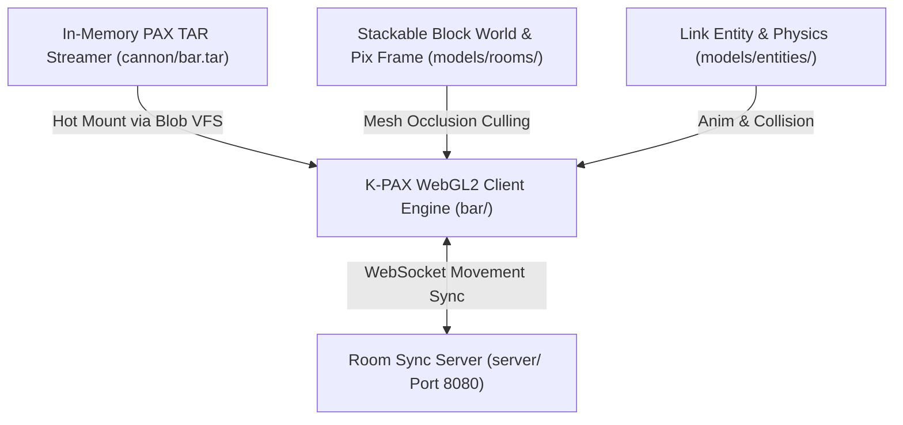

# K-PAX (`github.com/addressbar-net/kpax`)

**K-PAX** is the standalone 3D action-adventure game engine, modular block realm generator, and multiplayer room server for the [addressbar-net](https://github.com/addressbar-net) ecosystem.

It provides everything needed to host a room server, render stackable block worlds with neighbor occlusion culling, and travel seamlessly across servers using in-memory POSIX PAX TAR archives.

---

## Architecture Overview



---

## Core Symbolic Mechanics

1. **Link = Hyperlink**:
   Link is the traveler and spatial anchor of the network. He traverses block landscapes, mounts vehicles, and interacts with world nodes.
2. **Tricurse = Cursor**:
   The golden three-pronged Tricurse reticle floats above spawn points and exits, acting as an overhead spatial mouse cursor.
3. **The "Click" (Key [K])**:
   Positioning Link directly beneath a Cursor reticle or before a **Pix Frame** and pressing <kbd>K</kbd> performs an in-world **Click**.
4. **K-PAX TAR Travel**:
   Clicking mounts or exports the current room as a standalone POSIX PAX TAR parcel (`bar.tar`), or connects Link across room servers without reloading the browser window.

---

## The Block Realm & Optimization

* **Modular Stacking**:
  The realm is constructed from standardized $2.0\text{m} \times 2.0\text{m}$ blocks (emerald grass tops, stone foundation bevels, mahogany timber stacks).
* **Adjacent Neighbor Culling (Hidden Face Removal)**:
  Interior faces between adjacent or vertically stacked blocks are omitted from the geometry buffers during generation, reducing raw vertex overhead by $75\%+$.
* **The Pix Frame Aperture**:
  The Pix Frame is an optical projection shrine. Gazing through its optical Pix Glass aperture and pressing <kbd>K</kbd> solidifies light eastward into the mist, generating new $8 \times 8$ parcels on demand.
* **Sub-Rooms & Portal Culling**:
  Constructing enclosed buildings (walls, roof, door) registers a Sub-Room volume. Crossing the doorway threshold culls the exterior landscape entirely, enabling hundreds of detailed interior rooms on a single server.

---

## Directory Layout

```text
/kpax/
├── index.html              # Standalone WebGL game client & TAR Blob loader
├── install.sh              # 1-command installer for dependencies & rooms
├── start.sh                # Room server & client launcher
├── bar/                    # WebGL2 client engine (core, controls, physics, ui)
├── server/                 # Node.js WebSocket & SQLite room server (Port 8080)
├── models/
│   ├── entities/           # Link player entity (player.gltf, player.bin, ego_wings)
│   ├── rooms/              # 8x8 Starter Parcel (world.gltf, world.bin)
│   └── props/              # Door, entrance pipe, tricurse cursor
├── tools/                  # Procedural block builders (build_starter_parcel.js, meshBuilder.js)
├── compiler/               # In-engine PAX TAR compiler (reload.php, reload.sh)
└── cannon/                 # Compiled game archive (bar.tar)
```

---

## Quickstart & Installation

### 1. Installation
Clone the repository and run the automated installer:
```bash
git clone https://github.com/addressbar-net/kpax.git
cd kpax
./install.sh
```

### 2. Launching the Room Server & Engine
Start the WebSocket server on port 8080:
```bash
./start.sh
```

### 3. Playing the Game
Serve the `kpax/` directory with any static HTTP server:
```bash
python3 -m http.server 8000
```
Open **`http://localhost:8000`** in any WebGL-capable browser.

---

## Controls

| Key / Input | Action |
| :--- | :--- |
| **W / A / S / D** | Move / Run across block terrain |
| **Shift** | Sprint (+50% speed) |
| **Space** | Somersault Roll / Flight descent |
| **Key [K]** | **"Click" under Cursor / Pix Frame Expansion** |
| **Tab** | Inventory / Debug / Settings Menu |
| **Gamepad (PS5 / Xbox)** | Full dual-stick analog movement & camera rotation |
